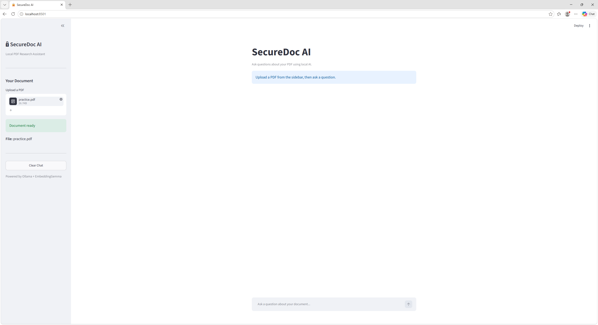
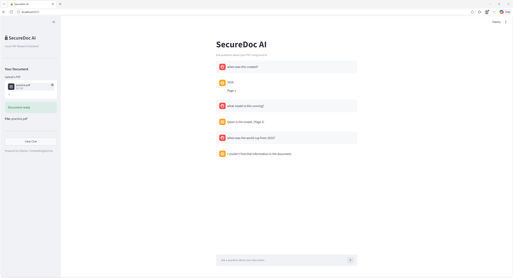

#  SecureDoc AI

locally running PDF question-answering application built with Python, Streamlit, Ollama, and EmbeddingGemma.

SecureDoc AI uses **Retrieval-Augmented Generation (RAG)** to retrieve relevant information from an uploaded PDF and generate answers grounded in the document.

## Features

- Upload and ask questions about PDF documents.
- Run language-model inference locally using Ollama and Qwen3.
- Generate semantic embeddings using Google's EmbeddingGemma model.
- Retrieve relevant passages using cosine similarity.
- Display AI-generated answers with page references.
- Maintain separate document indexes for individual Streamlit sessions.
- Reject unsupported file formats and PDFs larger than 10 MB.
- Provide a chat interface with conversation history and a clear-chat option.

## Screenshots

### Document Upload
Upload a PDF and prepare it for semantic search.



### AI Question Answering
Ask questions and receive document-grounded answers with page references.



## Technology Stack

| Technology | Purpose |
|---|---|
| Python | Application logic |
| Streamlit | Web interface |
| PyMuPDF | PDF text extraction |
| Sentence Transformers | Embedding model interface |
| EmbeddingGemma | Semantic text embeddings |
| NumPy | Vector similarity search |
| Ollama | Local language-model runtime |
| Qwen3 4B | Answer generation |

## How It Works

1. **Upload:** The user uploads a PDF through Streamlit.
2. **Extract:** PyMuPDF extracts readable text from each page.
3. **Chunk:** The extracted text is divided into smaller, overlapping passages.
4. **Embed:** EmbeddingGemma converts passages into numerical vectors.
5. **Search:** The user's question is embedded and compared against document vectors using NumPy.
6. **Generate:** Relevant passages are provided to Qwen3 through Ollama.
7. **Respond:** The application generates an answer using retrieved document context.

### Architecture

```text
             User
              |
              v
        Streamlit UI
              |
              v
          PDF Upload
              |
              v
       PyMuPDF Extraction
              |
              v
         Text Chunking
              |
              v
     EmbeddingGemma Model
              |
              v
    Session Document Index
              |
              v
       Similarity Search
              |
              v
        Retrieved Passages
              |
              v
         Ollama / Qwen3
              |
              v
       Answer + Page References
```

## Security Design

SecureDoc AI was developed with a focus on limiting unnecessary access to user data.

- **Local inference:** PDF question answering runs using locally hosted models rather than a hosted language-model API.
- **Read-only retrieval:** The document-search tool retrieves passages without modifying the original PDF.
- **Session isolation:** Each Streamlit session stores its own document embeddings and chunks.
- **Restricted tool interface:** Search requests are validated and limited to the provided document index.
- **Input validation:** The application checks PDF file headers, file sizes, and search-query lengths.
- **Prompt-injection precautions:** Retrieved PDF text is treated as untrusted content rather than instructions.

These measures reduce certain risks but do not constitute a complete security audit or guarantee protection against all prompt-injection attacks.

## Installation

### Prerequisites

- Python with support for the listed dependencies
- Ollama installed and running
- Sufficient memory to run Qwen3 and EmbeddingGemma

### 1. Clone the repository

```bash
git clone https://github.com/YOUR_USERNAME/securedoc-ai.git
cd securedoc-ai
```

### 2. Create a virtual environment

```bash
python -m venv .venv
```

On Windows PowerShell:

```powershell
.\.venv\Scripts\Activate.ps1
```

### 3. Install Python dependencies

```bash
python -m pip install -r requirements.txt
```

### 4. Download the local language model

```bash
ollama pull qwen3:4b-instruct
```

The EmbeddingGemma model will be downloaded by Sentence Transformers when first needed. Initial setup may require an internet connection and acceptance of any applicable model access terms.

### 5. Start the application

Ensure Ollama is running, then execute:

```bash
python -m streamlit run app.py
```

Open the local Streamlit URL displayed in your terminal.

## Limitations

- Supports text-based PDFs;
- Processes one active PDF per Streamlit session.
- Document embeddings are stored in memory and are not persisted to a vector database.
- Model performance depends on available hardware.
- Generated answers may contain inaccuracies and should be checked against the cited PDF pages.
- Intended for local use and demonstration, not as a production-hardened multi-user service.

## Future Improvements

- Add automated retrieval and security tests.
- Improve source citation validation.
- Implement optional persistent vector storage.
- Add stronger authentication and deployment controls.

## Project Motivation

I built SecureDoc AI to explore how large language models can work with private documents using Retrieval-Augmented Generation.

The project helped me gain practical experience with PDF processing, semantic search, local language models, Python application architecture, and security-conscious software design.